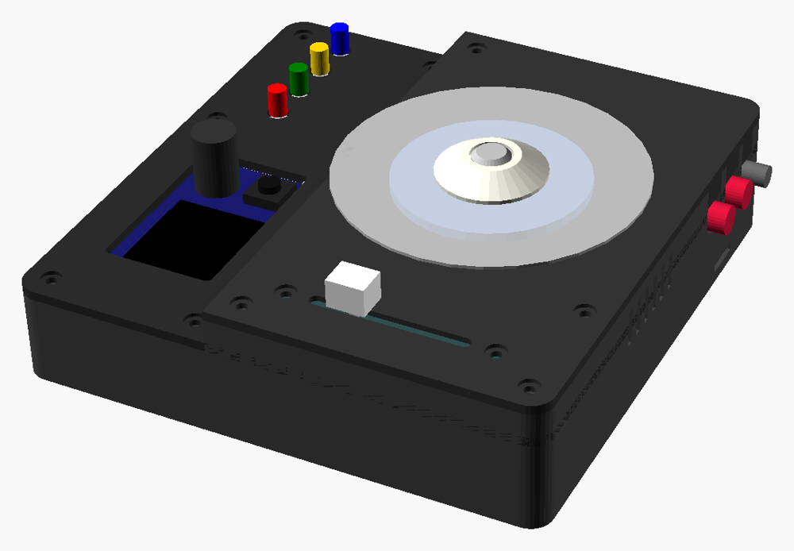
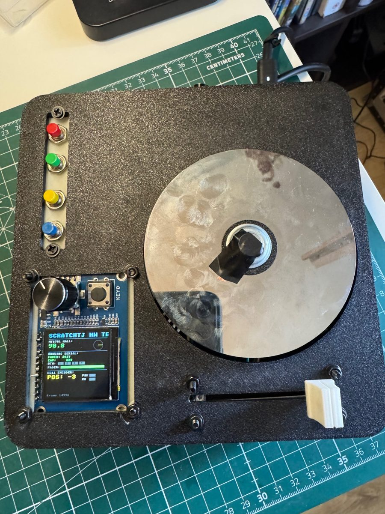
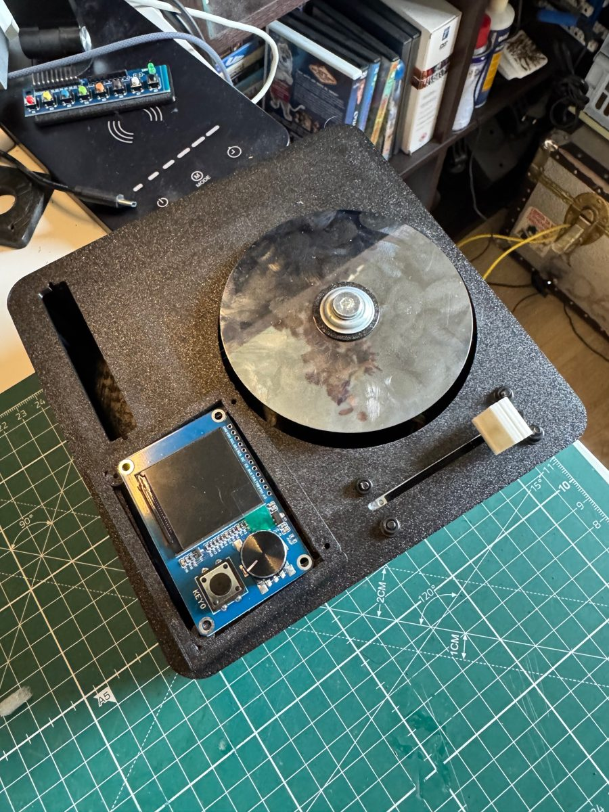
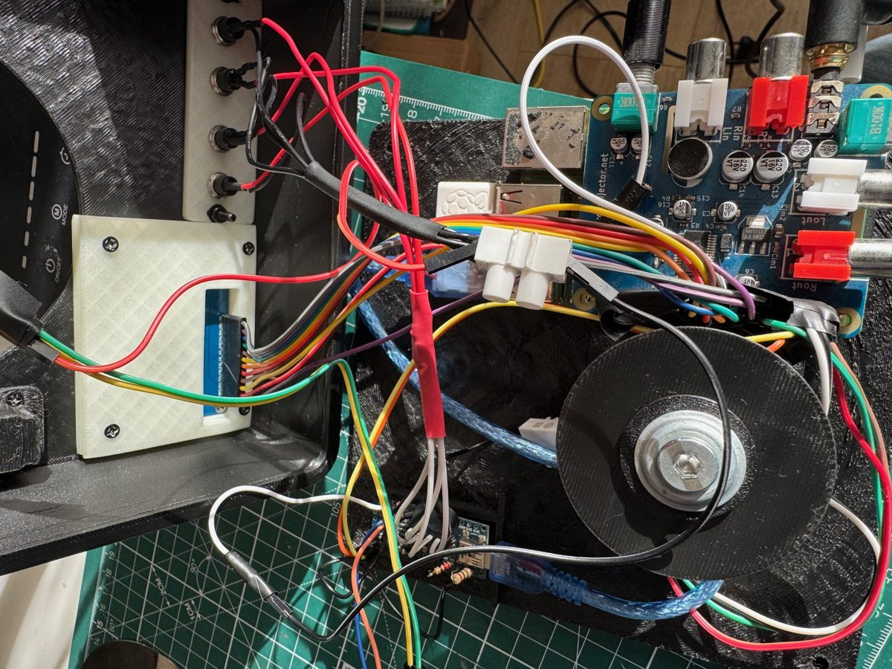
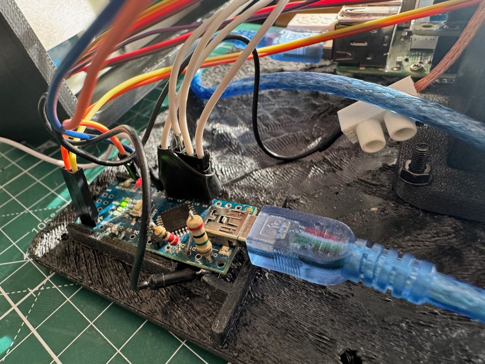

<div align="center">

# ScratchTJ

**A DIY portable digital scratch turntable: Raspberry Pi 2, magnetic platter sensing, a real scratch fader and a 3D-printed case.**

[](LICENSE)
[](docs/HARDWARE.md#raspberry-pi-2-model-b)
[](software/)
[](arduino_nano/)
[](enclosure/scratchtj_stepped.scad)
[](enclosure/README.md)
[](http://www.xwax.co.uk/)
[](https://github.com/rasteri/SC1000)



</div>

ScratchTJ is a self-contained scratch instrument. Two decks (a beat and a
scratch sample) play from a Raspberry Pi. You scratch the sample with a
touch-sensitive metal platter and cut it with a hall-effect scratch fader. A
small colour screen with a rotary knob gives you the menus, so you never need
a monitor or a keyboard.

Everything is in this repository: the audio software (C), the Arduino
firmware, the hardware test tools, and a parametric OpenSCAD enclosure with
ready-to-print STL files.

## Contents

- [Features](#features)
- [Photos](#photos)
- [How it works](#how-it-works)
- [Components](#components)
- [Repository layout](#repository-layout)
- [Quick start](#quick-start)
- [Documentation](#documentation)
- [Credits and license](#credits-and-license)

## Features

- **Two decks**: deck 1 plays beats from `~/beats`, deck 2 plays scratch
  samples from `~/samples`; both go through the fader.
- **Magnetic platter sensing**: an MT6701 14-bit angle sensor reads a magnet on
  the platter shaft. It has no contacts and no drift, and it is silent at rest.
- **Touch-sensitive platter**: capacitive sensing through the bearing tells the
  software when your hand is on the platter, as on a real turntable.
- **Scratch fader**: an Innofader Mini Pro (hall effect, short throw) read by
  an Arduino Nano, with an adjustable cut curve.
- **240×240 colour display + rotary knob**: live platter view, file browser,
  recording, and every parameter adjustable live.
- **4 cue buttons** with two modes: **CUE** (jump to / set cue points) and
  **SETTINGS** (hold a button and turn the platter to change pitch, platter
  speed, pitch bend or volume).
- **Live recording** from the sound card input straight into a deck.
- **FTP access** to the beats and samples folders from any computer on your
  network.
- **Compact 3D-printed case**: 168 × 168 mm, a stepped top with flat decks,
  7 parts that print without supports and screw together with M2/M3 screws.

## Photos

| | |
|---|---|
|  |  |
| *Prototype: platter, fader, display, knob and the four cue buttons* | *Hard disk platter on the bearing hub* |
|  |  |
| *Inside: Pi + AudioInjector, DuPont wiring, platter axle* | *Arduino Nano reading the fader, touch and buttons* |

## How it works

```
                      USB serial, 500 kbaud                 I2S
 ┌──────────────────┐  7-byte packets, ~kHz  ┌───────────────────────┐      ┌──────────────────┐
 │  ARDUINO NANO    │ ─────────────────────► │  RASPBERRY PI 2       │ ───► │  AudioInjector   │ ──► line out /
 │  fader      (A5) │                        │                       │      │  stereo (WM8731) │     headphones
 │  touch  (D10/12) │                        │  xwax audio engine    │ ◄─── │  line in         │ ◄── record source
 │  4 cue (A0–A3)   │                        │  platter + fader DSP  │      └──────────────────┘
 └──────────────────┘                        │  menus + display      │
                                             │                       │ ◄─── I2C ──── MT6701 angle sensor
                                             │                       │ ──── SPI ───► ST7789 display
                                             │                       │ ◄─── GPIO ─── EC11 knob + key
                                             └───────────────────────┘
```

- The **Arduino** samples the fader, the touch sensor and the cue buttons and
  sends them to the Pi as small binary packets over its USB cable.
- The **Pi** reads the platter angle directly from the MT6701 over I2C, turns
  platter movement into playback position (with a slipmat model when you let
  go), applies the fader curve, and drives the display and menus.
- The **AudioInjector** sound card plays both decks and records from its input.

More detail: [docs/HARDWARE.md](docs/HARDWARE.md) and [docs/SOFTWARE.md](docs/SOFTWARE.md).

## Components

ScratchTJ is built and tested on a **Raspberry Pi 2 Model B**. Full list with
dimensions, the reason for each part, and the wiring:
[docs/HARDWARE.md](docs/HARDWARE.md).

| Part | What it does |
|------|--------------|
| Raspberry Pi 2 Model B + microSD + 5 V / 2 A supply | Runs the audio engine, menus and display |
| AudioInjector Stereo sound card (WM8731 HAT) | Audio out (RCA + headphones) and line in for recording |
| Arduino Nano (CH340 clone is fine) | Reads fader, touch sensor and cue buttons |
| MT6701 magnetic angle sensor board (I2C) | Measures platter angle, 14 bit |
| Small diametric disc magnet (2 mm thick) | Glued to the tip of the platter bolt, read by the MT6701 |
| ST7789 1.54" 240×240 SPI display with EC11 knob and key | Screen and menu controls on one board |
| Innofader Mini Pro | Scratch fader |
| 4 panel push buttons (7 mm) | Cue / settings buttons |
| 95 mm metal platter (3.5" HDD platter) | The surface you scratch |
| Ball bearing (18 mm OD × 6 mm), M5 × 27 bolt, M5 nut, washers | Platter axle |
| 1.2 kΩ resistor and a thin wire | Capacitive touch circuit |
| M3 and M2 screws, DuPont jumper wires | Assembly |
| 7 printed parts | [The enclosure](enclosure/README.md) |

## Repository layout

```
.
├── software/        xwax-based audio engine, menus and drivers (C, builds on the Pi)
├── arduino_nano/    Arduino firmware: fader, capacitive touch, cue buttons
├── hw_test/         Stand-alone hardware tests (display, sensor, serial, Arduino)
├── enclosure/       Parametric OpenSCAD case, ready-to-print STLs, renders
│   ├── scratchtj_stepped.scad
│   ├── stl/
│   ├── images/
│   └── diagrams/
└── docs/            Hardware, installation, usage and software guides
```

## Quick start

1. **Print the case**: the seven files in [`enclosure/stl/`](enclosure/stl/).
   See [enclosure/README.md](enclosure/README.md) for print settings, screws
   and assembly order.
2. **Wire it up**: follow the pin tables in [docs/HARDWARE.md](docs/HARDWARE.md#wiring).
3. **Flash the Arduino** with [`arduino_nano/arduino_nano.ino`](arduino_nano/arduino_nano.ino)
   (needs the `CapacitiveSensor` library).
4. **Set up the Pi** (32-bit Raspberry Pi OS, I2C + SPI on, AudioInjector
   overlay) and build:

   ```bash
   git clone <this repository> ~/ScratchTJ
   cd ~/ScratchTJ/software
   make -j4
   sudo LC_ALL=en_GB.utf8 nice -n -19 ./xwax
   ```

   Step by step: [docs/INSTALLATION.md](docs/INSTALLATION.md).
5. **Add music**: put beats in `~/beats/` and scratch samples in `~/samples/`
   (WAV 16-bit stereo loads fastest), by USB stick, `scp` or FTP.
6. **Play**: [docs/USAGE.md](docs/USAGE.md) explains the controls, menus and
   parameters.

## Documentation

| Document | Contents |
|----------|----------|
| [docs/HARDWARE.md](docs/HARDWARE.md) | Every component, why it was chosen, full wiring and pin map, touch circuit |
| [docs/INSTALLATION.md](docs/INSTALLATION.md) | Raspberry Pi OS setup, sound card, build, autostart, Arduino flashing, FTP |
| [docs/USAGE.md](docs/USAGE.md) | Controls, menu tree, button modes, live parameters |
| [docs/SOFTWARE.md](docs/SOFTWARE.md) | Threads, modules, serial protocol, configuration files |
| [enclosure/README.md](enclosure/README.md) | Printed parts, print settings, screw list, platter stack, assembly, editing the model |
| [hw_test/README.md](hw_test/README.md) | Hardware test programs |

## Credits and license

ScratchTJ is a fork of **[SC1000](https://github.com/rasteri/SC1000)** by
**the_rasteri**, the open-source portable scratch turntable, and is built on
**[xwax](http://www.xwax.co.uk/)** by Mark Hills. Neither project's work is
replaced here: ScratchTJ adapts it to a Raspberry Pi with off-the-shelf parts.

- [xwax](http://www.xwax.co.uk/), Mark Hills: digital vinyl engine
- [SC1000](https://github.com/rasteri/SC1000), the_rasteri: the instrument this is forked from
- [AudioInjector](http://www.audioinjector.net/): sound card
- [CapacitiveSensor](https://github.com/PaulStoffregen/CapacitiveSensor), Paul Badger / Paul Stoffregen: Arduino touch library

Licensed under the **GNU General Public License v2**, see [LICENSE](LICENSE).
