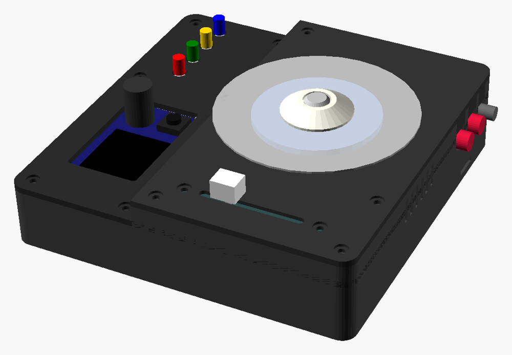
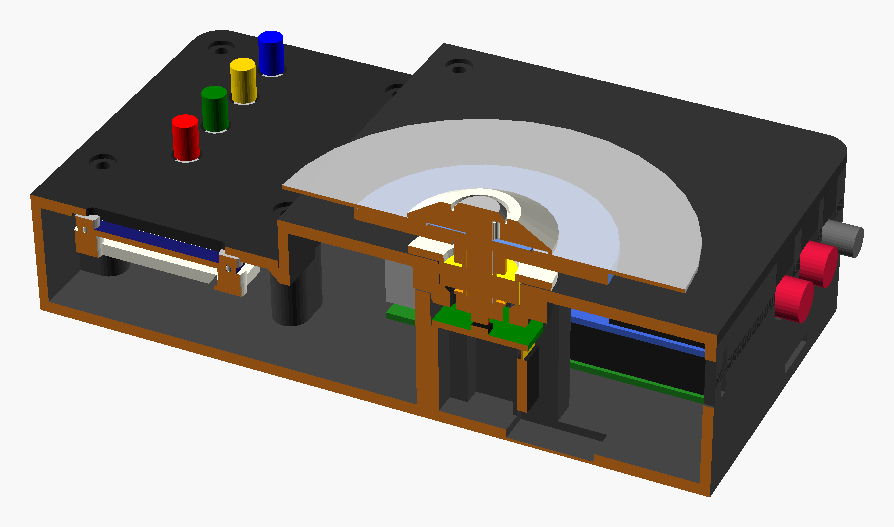
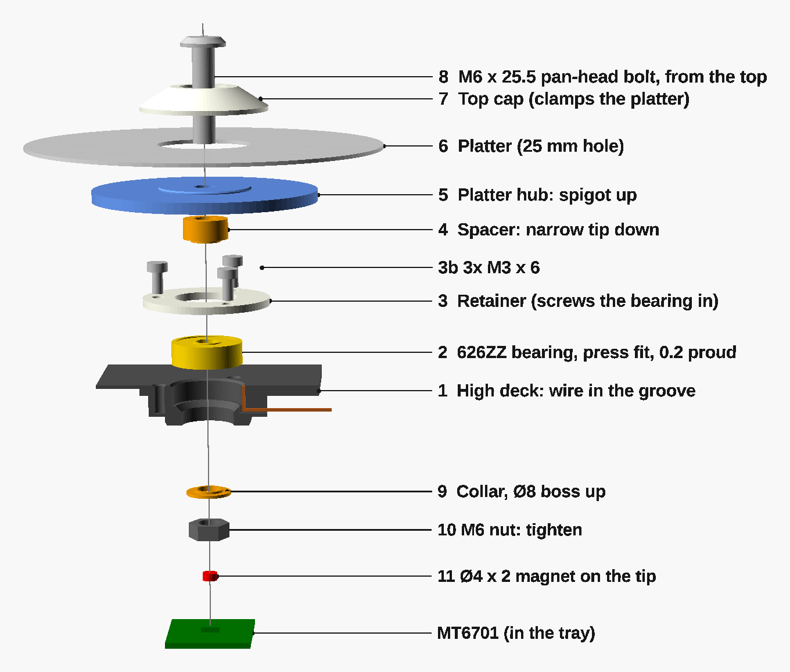
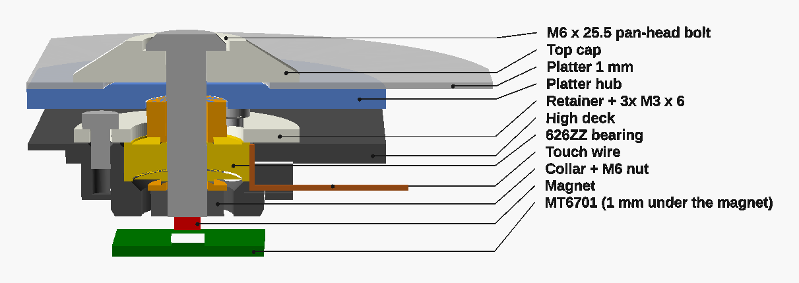

# Enclosure

A parametric OpenSCAD case for ScratchTJ: **168 × 168 mm**, with a stepped top.
The high deck (43 mm) carries the platter and the fader. The low deck (32 mm)
carries the display and the cue buttons. All nine parts print without
supports on a 180 mm bed and screw together with M3 and M2 machine screws.



- [Files](#files)
- [Parts](#parts)
- [Printing](#printing)
- [Screws and hardware](#screws-and-hardware)
- [Platter stack](#platter-stack)
- [Assembly](#assembly)
- [Editing the model](#editing-the-model)
- [Values to check before printing](#values-to-check-before-printing)

---

## Files

| Path | Contents |
|------|----------|
| [`scratchtj_stepped.scad`](scratchtj_stepped.scad) | The whole model: parameters, every part, mock-ups of the electronics, assembly views |
| [`stl/`](stl/) | Ready-to-print STL files, one per part, already in print orientation |
| [`export_stl.sh`](export_stl.sh) | Re-exports all STLs from the SCAD file |
| [`images/`](images/) | Renders used in this guide |
| [`diagrams/`](diagrams/) | Platter stack diagram source and its render script |

## Parts


| # | STL | Part | What it holds |
|---|-----|------|---------------|
| 1 | [`01_tray.stl`](stl/01_tray.stl) | **Tray** | Floor, walls and screw posts in one rigid piece. Holds the Pi + AudioInjector, the Arduino Nano and the MT6701 sensor tube. Openings for RCA, headphone jack, pots, power, HDMI and microSD |
| 2 | [`02_high_deck.stl`](stl/02_high_deck.stl) | **High deck** | Flat plate with the bearing seat and the fader slot. A riser along its left edge forms the step |
| 3 | [`03_low_deck.stl`](stl/03_low_deck.stl) | **Low deck** | Flat plate with the display window and the four button holes. Rests on a ledge of the riser and clamps the high deck along the step |
| 4 | [`04_display_carrier.stl`](stl/04_display_carrier.stl) | **Display carrier** | The display board screws onto it through its own corner holes; the carrier screws under the low deck. Nothing presses on the board edges |
| 5 | [`05_platter_hub.stl`](stl/05_platter_hub.stl) | **Platter hub** | Ø60 × 3 mm flange the platter rests on, with a Ø24.8 spigot that centres the platter's 25 mm hole and a 6.1 mm bore for the M6 bolt |
| 6 | [`06_hub_spacer.stl`](stl/06_hub_spacer.stl) | **Hub spacer** | Sits between hub and bearing and presses on the bearing's inner race only |
| 7 | [`07_bearing_retainer.stl`](stl/07_bearing_retainer.stl) | **Bearing retainer** | 2 mm ring (ID 17, OD 34) screwed over the bearing so it cannot come out of the top when you lift the platter |
| 8 | [`08_platter_cap.stl`](stl/08_platter_cap.stl) | **Platter cap** | Replaces a wide washer: clamps the platter on its rim, holds the bolt head in a pocket and guides the touch wire. Its thickness sets the magnet height |
| 9 | [`09_bearing_collar.stl`](stl/09_bearing_collar.stl) | **Bearing collar** | Ø12 × 1.4 mm ring under the bearing with a Ø8 boss that touches only the inner race; the M6 nut tightens against it |

With both decks off, everything in the tray stays in place:


The section through the step and the platter axis shows how the parts stack:



## Printing

All parts in one view (overview only; print the separate STLs):


| Setting | Value |
|---------|-------|
| Printer | Any printer with a bed of at least 170 × 170 mm (designed on a Bambu Lab A1 mini) |
| Material | PETG (PLA works for test fits) |
| Nozzle / layer | 0.4 mm / 0.2 mm |
| Walls | 3 or more: the screws cut their thread into the plastic |
| Infill | 20–25 % |
| Supports | **None** |

The STLs are already oriented for printing:

| Part | Orientation |
|------|-------------|
| Tray | Upright, floor on the bed |
| High deck, low deck | Face down: the outside surface on the bed, so it comes out flat and clean |
| Platter cap | Underside (the groove for the touch wire) on the bed |
| Collar | Wide Ø12 base on the bed, boss up |
| Carrier, hub, spacer, retainer | As exported, flat side on the bed |

| High deck (as printed) | Low deck (as printed) |
|---|---|
|  |  |

| Tray | Display carrier |
|---|---|
|  |  |

**Test print first.** Set `DRAFT = true` in the SCAD file and export: the tray
floor and both decks become a lattice. Walls, posts, bosses, seats and screw
holes stay exactly as in the real parts, so you can check every fit with a
fraction of the plastic and print time.

## Screws and hardware

Only machine screws, driven straight into the plastic. The pilot holes are
drawn slightly oversize (M3: 2.8 mm, M2: 1.8 mm) because printed holes come out
tight; the screw cuts its own thread. Clearance holes for M3 are 3.4 mm.

| Where | Screw | Qty |
|-------|-------|-----|
| Low deck → tray posts | M3 × 10 or 12 | 6 |
| High deck → tray posts | M3 × 10 or 12 | 4 |
| Fader → high deck (into the fader's own threads) | M3 × 6 countersunk or M3 × 5 pan | 2 |
| Display carrier → low deck bosses | M3 × 8 | 4 |
| Display board → carrier | M3 × 6 or 8 | 4 |
| Bearing retainer → high deck | M3 × 6 | 3 |
| Raspberry Pi → tray standoffs | M2 × 6 or 8 | 4 |
| MT6701 board → sensor tube | M2 × 6 | up to 4 |

The deck screw holes have flat recesses for **pan, button or cap heads**
(`m3_head = "pan"`). For countersunk screws flush with the deck, set
`m3_head = "csk"` and re-export.

Do not use longer screws in the fader: the Innofader manual warns against
driving screws deep into its body.

Platter axle hardware:

| Part | Size |
|------|------|
| Ball bearing | **626ZZ**, 6 × 19 × 6 mm (bore × OD × width) |
| Bolt | **M6 pan head**, 25.5 mm under the head (about 27 mm overall), head about 12 mm wide and 2.5 mm high |
| Nut | M6 hex, 4 mm thick |
| Magnet | Diametric disc, **Ø4 × 2 mm** |
| Platter | 95 mm, 1 mm thick, 25 mm centre hole (3.5" hard disk platter) |

## Platter stack

| Exploded | Section |
|---|---|
|  |  |

From top to bottom:

1. **Bolt head** (M6 pan head) in the pocket of the top cap.
2. **Top cap** (printed, 6.3 mm tall, 4.8 mm under the bolt head): clamps the
   platter on its rim (radius 12.5 to 17 mm). It is plastic, so a short
   stripped wire carries the touch signal: one end goes up the small hole in
   the cap and is pinched under the bolt head, the other lies in the groove on
   the cap's underside and is pinched against the platter top.
3. **Platter**, resting on the hub flange. The hub spigot is 0.3 mm lower than
   the platter top, so the cap always clamps metal.
4. **Hub** (printed): Ø60 × 3 mm flange, Ø24.8 spigot, 6.1 mm bore (snug on the
   M6, so it centres the platter on the bolt).
5. **Spacer** (printed, 5.2 mm plus 1 mm sunk into the hub): presses on the
   bearing inner race only, never on the shields or the outer race.
6. **Retainer ring** (printed, 2 mm, 3 × M3 × 6 at radius 13 mm): holds the
   outer race down.
7. **Bearing 626ZZ**, press fit in a Ø19.15 × 5.8 mm seat, top **0.2 mm proud**
   so the retainer presses on it. A 1 mm ledge under the outer race takes the
   downward push.
8. **Collar + M6 nut** under the bearing: the collar's Ø8 boss touches only the
   inner race, and the nut locks the bolt to it. Both turn with the platter.
   There is 5.5 mm of thread below the bearing for the 1.4 mm collar and the
   4 mm nut.
9. **Magnet** Ø4 × 2 mm, glued centred on the bolt tip, **1 mm above the MT6701
   chip**.

Key heights (z = 0 is the outside face of the high deck):

| Item | Value |
|------|-------|
| Platter | bottom 8.4 mm and top 9.4 mm over the deck, 51.4 and 52.4 mm above the table |
| Bolt head underside | 14.2 mm over the deck |
| Bolt tip | 11.3 mm under the deck |
| Magnet face to MT6701 chip | 1 mm (chip 1.5 mm tall, board top 15.8 mm under the deck) |
| Decks | high 43 mm, low 32 mm, step 11 mm |

The bolt is the only length that matters. The cap is designed for the 25.5 mm
reading. With a 24.6 mm bolt the magnet simply sits 1.9 mm from the chip
(still in range) and the nut hangs 0.8 mm past the tip. A longer bolt would
hit the chip. If the gap is wrong on the real thing, reprint only the cap: 1 mm
thicker moves the magnet 1 mm up.

**Touch path:** a thin wire runs up a groove in the bearing seat wall and is
pinched by the outer race. The signal goes outer race → balls → inner race →
bolt → stripped wire → platter. No slip ring is needed. The groove points
towards the Nano, and the retainer screws are placed clear of it. See
[docs/HARDWARE.md](../docs/HARDWARE.md#capacitive-touch) for the circuit.

## Assembly

1. **Tray.** Screw the Pi onto its standoffs (4 × M2) with the SD card end
   towards the right wall, and fit the AudioInjector on its header. Put the
   Nano in its rails with the USB plug pointing left. Screw the MT6701 board
   into the sensor tube (M2) with its cable out through the slot. The Pi's USB
   ports face left: the Nano's USB cable passes under the riser.
2. **Wire it up** with DuPont jumpers, following
   [docs/HARDWARE.md](../docs/HARDWARE.md#wiring). The deck heights leave room
   for straight DuPont plugs plus a bend in the wire.
3. **High deck.** Lay the touch wire in the groove of the bearing seat, press
   the bearing in, and screw the retainer ring on (3 × M3 × 6). Fit the fader
   from below and screw it from the top (2 × M3 × 6 countersunk or M3 × 5 pan).
4. **Platter.** Drop the bolt through the cap, the platter, the hub, the
   spacer and the bearing, with the stripped touch wire under the bolt head and
   in the cap groove. Underneath, add the collar (boss up) and the M6 nut and
   tighten until the platter turns freely without play. Glue the magnet,
   centred, onto the bolt tip.
5. **Low deck.** Fit the four buttons. Screw the display board onto the carrier
   (4 × M3), then the carrier under the deck (4 × M3 × 8).
6. **Close.** Put the high deck on its posts (4 × M3), then the low deck
   (6 × M3). The low deck sits on the riser ledge and clamps the high deck.
   Spin the platter by hand: no rubbing, no wobble.

## Editing the model

Open `scratchtj_stepped.scad` in [OpenSCAD](https://openscad.org/) (a 2024+
build with the Manifold backend renders in seconds). Everything is driven by
the variables at the top of the file.

**What to show:** set `SHOW` and press F5.

| `SHOW` | View |
|--------|------|
| `assembly` | Complete instrument with mock electronics |
| `exploded` | Decks lifted off the tray |
| `open` | Tray with electronics, decks removed |
| `section` | Cut across the step through the platter axis |
| `platter_section` | Close-up cut through the platter axis |
| `tray`, `high`, `low`, `carrier`, `hub`, `spacer`, `retainer`, `clamp` (platter cap), `collar` | One part, in print orientation |
| `coupon` | Fit test: four bearing seats (Ø19.0 to 19.3) and a hub test (spigot and bore steps). Print it first to tune the fits |
| `print` | All parts laid out (overview only) |

Layer toggles: `show_tray`, `show_decks`, `show_mock` (Pi, Nano, display,
fader, platter, DuPonts), `show_labels` (text; slow, keep it off while
editing), `deck_alpha` (see-through decks), `explode_gap`.

**Heights are automatic.** With `h_high = 0` and `h_low = 0` each deck is made
as low as its contents allow: the Pi stack and the sensor with its DuPont
plugs under the high deck, the display and buttons under the low deck. The
console prints what each needs and how much room is left. Every millimetre cut
off the platter bolt makes the box one millimetre lower.

**Export the STLs** after changing anything:

```bash
./export_stl.sh        # all nine parts into stl/
# or one part:
openscad -o stl/02_high_deck.stl -D 'SHOW="high"' scratchtj_stepped.scad
```

**Platter diagrams:** `diagrams/render_diagrams.sh` re-renders
`images/platter_exploded.png` and `images/platter_section.png` from
`diagrams/platter_stack.scad`.

## Values to check before printing

Parameters tagged `MEASURE` in the SCAD file come from photos or datasheets,
not from calipers. Check them against your own parts:

| Parameter | Value | What |
|-----------|-------|------|
| `fad_m3_sp`, `fad_slot_x`, `fad_slot_y` | 65 / 50 / 4 mm | Fader screw spacing and lever slot |
| `btn_hole_d`, `btn_depth` | 7.3 / 19 mm | Button bushing hole and depth under the panel |
| `disp_hole_d`, `disp_hdr_x`, `disp_hdr_y0` | 3.2 / 2.5 / 8 mm | Display board holes and header position |
| `pi_stack_top` | 27 mm | Pi PCB underside to the top of the RCA jacks |
| `nano_x` | 45 mm | Nano board length |
| `brg_seat_d` | 19.15 mm | Bearing seat (626ZZ is 19.0 mm). Printed holes come out about 0.1 small |
| `hub_spigot_d`, `hub_bore` | 24.8 / 6.1 mm | Hub spigot (platter hole 25.0) and the M6 bore |
| `bolt_shank`, `bolt_head_h`, `bolt_head_d` | 25.5 / 2.5 / 12 mm | Bolt length under the head, pan head height and width |
| `nut_h` | 4 mm | M6 nut thickness |
| `enc_chip_h`, `mag_gap` | 1.5 / 1 mm | MT6701 chip height (SOP-8: 1.35 to 1.75) and magnet air gap |
| `brg_inner_d` | 8 mm | Inner race contact diameter for spacer and collar (the race land is about 9.5 mm) |

Measured on the real parts: platter (95 × 1 mm, 25 mm hole), 626ZZ bearing
(6 × 19 × 6 mm), M6 bolt (25.5 mm under the head, about 27 mm overall), M6 nut
(4 mm), magnet (Ø4 × 2 mm) and display board (41 × 65 mm, holes 37 × 60 mm).

**Fits are not yet checked with a coupon.** The seat (Ø19.15), spigot (Ø24.8) and bore
(Ø6.1) were set from earlier prints, not from a coupon. If the bearing is
too loose or too tight, or the platter does not drop over the hub, print
`SHOW="coupon"` and adjust `brg_seat_d`, `hub_spigot_d` or `hub_bore`.
