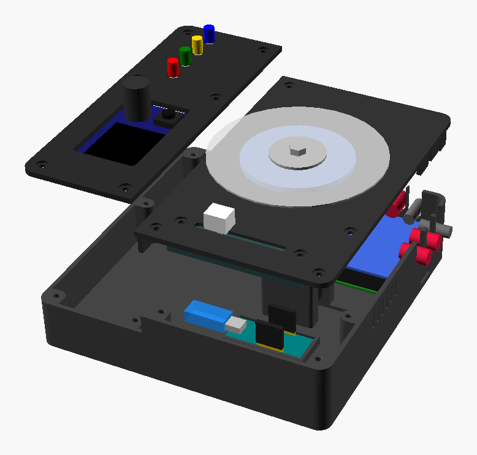
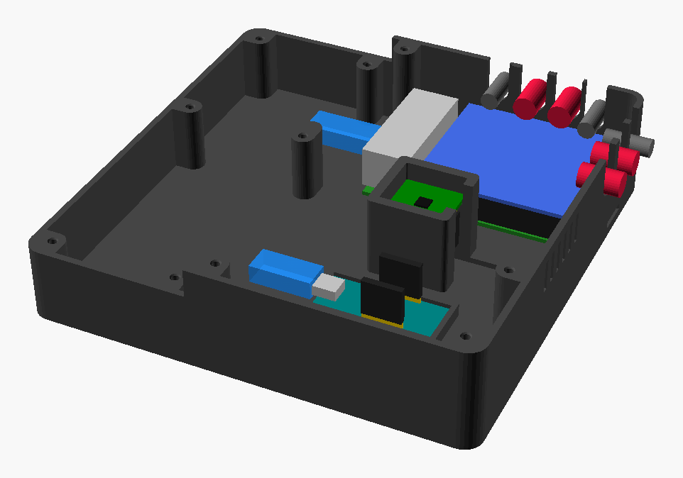
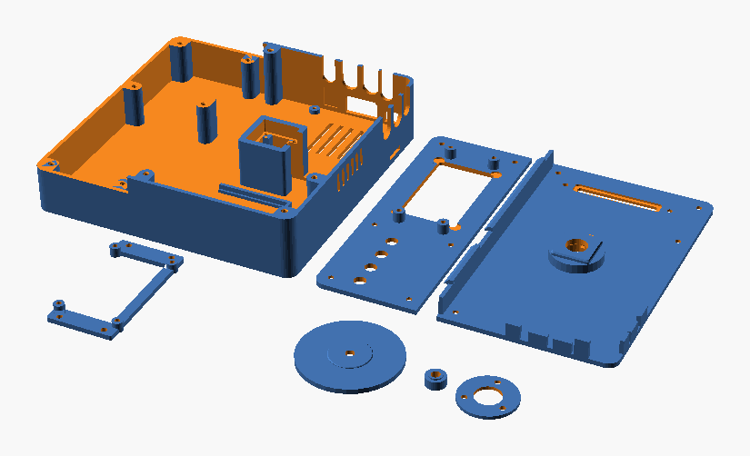
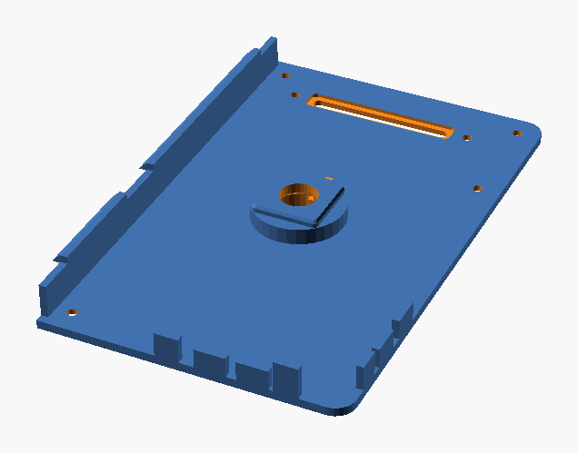
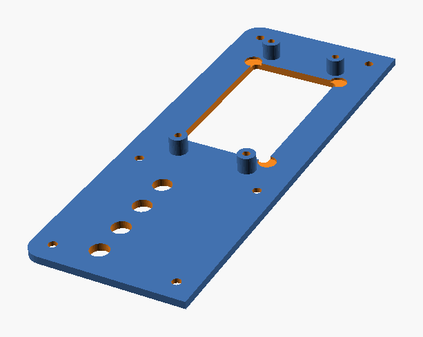
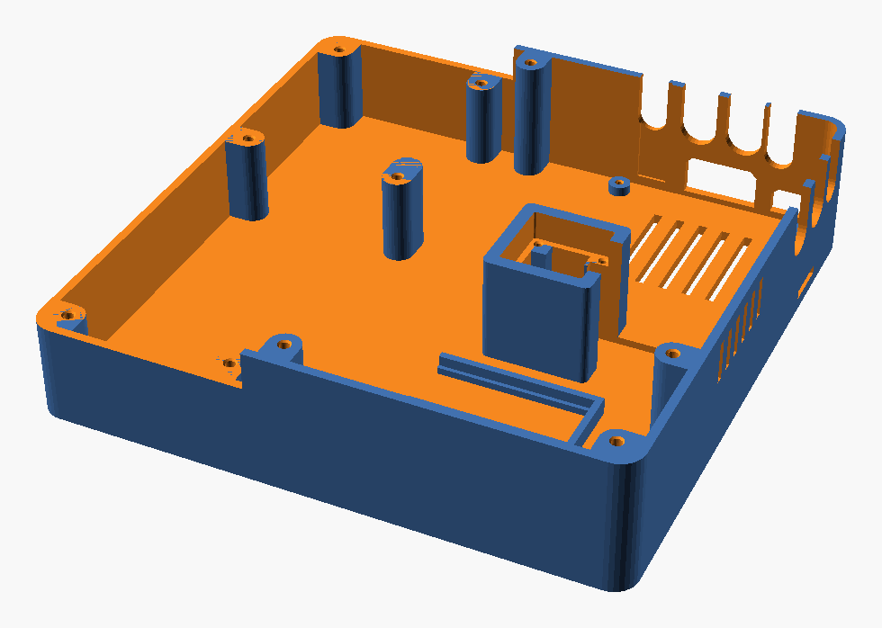
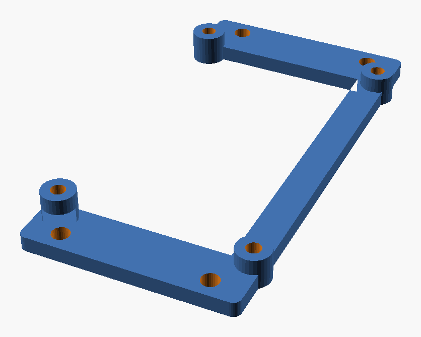

# Enclosure

A parametric OpenSCAD case for ScratchTJ: **168 × 168 mm**, with a stepped top.
The high deck (43 mm) carries the platter and the fader. The low deck (32 mm)
carries the display and the cue buttons. All seven parts print without
supports on a 180 mm bed and screw together with M3 and M2 machine screws.


- [Files](#files)
- [Parts](#parts)
- [Printing](#printing)
- [Screws and hardware](#screws-and-hardware)
- [Platter stack](#platter-stack)
- [Assembly](#assembly)
- [Editing the model](#editing-the-model)
- [Values to check before printing](#values-to-check-before-printing)

---

## Files

| Path | Contents |
|------|----------|
| [`scratchtj_stepped.scad`](scratchtj_stepped.scad) | The whole model: parameters, every part, mock-ups of the electronics, assembly views |
| [`stl/`](stl/) | Ready-to-print STL files, one per part, already in print orientation |
| [`export_stl.sh`](export_stl.sh) | Re-exports all STLs from the SCAD file |
| [`images/`](images/) | Renders used in this guide |
| [`diagrams/`](diagrams/) | Platter stack diagram source and its render script |

## Parts



| # | STL | Part | What it holds |
|---|-----|------|---------------|
| 1 | [`01_tray.stl`](stl/01_tray.stl) | **Tray** | Floor, walls and screw posts in one rigid piece. Holds the Pi + AudioInjector, the Arduino Nano and the MT6701 sensor tube. Openings for RCA, headphone jack, pots, power, HDMI and microSD |
| 2 | [`02_high_deck.stl`](stl/02_high_deck.stl) | **High deck** | Flat plate with the bearing seat and the fader slot. A riser along its left edge forms the step |
| 3 | [`03_low_deck.stl`](stl/03_low_deck.stl) | **Low deck** | Flat plate with the display window and the four button holes. Rests on a ledge of the riser and clamps the high deck along the step |
| 4 | [`04_display_carrier.stl`](stl/04_display_carrier.stl) | **Display carrier** | The display board screws onto it through its own corner holes; the carrier screws under the low deck. Nothing presses on the board edges |
| 5 | [`05_platter_hub.stl`](stl/05_platter_hub.stl) | **Platter hub** | 60 mm flange the platter rests on, with a spigot that centres the platter's 25 mm hole |
| 6 | [`06_hub_spacer.stl`](stl/06_hub_spacer.stl) | **Hub spacer** | Sits between hub and bearing and presses on the bearing's inner race only |
| 7 | [`07_bearing_retainer.stl`](stl/07_bearing_retainer.stl) | **Bearing retainer** | Ring screwed over the bearing so it cannot come out of the top when you lift the platter |

With both decks off, everything in the tray stays in place:



The section through the step and the platter axis shows how the parts stack:


## Printing

All parts in one view (overview only; print the separate STLs):



| Setting | Value |
|---------|-------|
| Printer | Any printer with a bed of at least 170 × 170 mm (designed on a Bambu Lab A1 mini) |
| Material | PETG (PLA works for test fits) |
| Nozzle / layer | 0.4 mm / 0.2 mm |
| Walls | 3 or more: the screws cut their thread into the plastic |
| Infill | 20–25 % |
| Supports | **None** |

The STLs are already oriented for printing:

| Part | Orientation |
|------|-------------|
| Tray | Upright, floor on the bed |
| High deck, low deck | Face down: the outside surface on the bed, so it comes out flat and clean |
| Carrier, hub, spacer, retainer | As exported, flat side on the bed |

| High deck (as printed) | Low deck (as printed) |
|---|---|
|  |  |

| Tray | Display carrier |
|---|---|
|  |  |

**Test print first.** Set `DRAFT = true` in the SCAD file and export: the tray
floor and both decks become a lattice. Walls, posts, bosses, seats and screw
holes stay exactly as in the real parts, so you can check every fit with a
fraction of the plastic and print time.

## Screws and hardware

Only machine screws, driven straight into the plastic. The pilot holes are
drawn slightly oversize (M3: 2.8 mm, M2: 1.8 mm) because printed holes come out
tight; the screw cuts its own thread. Clearance holes for M3 are 3.4 mm.

| Where | Screw | Qty |
|-------|-------|-----|
| Low deck → tray posts | M3 × 10 or 12 | 6 |
| High deck → tray posts | M3 × 10 or 12 | 4 |
| Fader → high deck (into the fader's own threads) | M3 × 6 countersunk or M3 × 5 pan | 2 |
| Display carrier → low deck bosses | M3 × 8 | 4 |
| Display board → carrier | M3 × 6 or 8 | 4 |
| Bearing retainer → high deck | M3 × 6 | 3 |
| Raspberry Pi → tray standoffs | M2 × 6 or 8 | 4 |
| MT6701 board → sensor tube | M2 × 6 | up to 4 |

The deck screw holes have flat recesses for **pan, button or cap heads**
(`m3_head = "pan"`). For countersunk screws flush with the deck, set
`m3_head = "csk"` and re-export.

Do not use longer screws in the fader: the Innofader manual warns against
driving screws deep into its body.

Platter axle hardware:

| Part | Size |
|------|------|
| Ball bearing | 18 mm OD × 6 mm |
| Bolt | M5 × 27 mm overall, hex head |
| Wide washer | M5 × 30 mm OD, **metal** (must be wider than the 25 mm platter hole) |
| Small washer | M5, under 10 mm OD |
| Nut | M5 |
| Magnet | Diametric disc, 2 mm thick |
| Platter | 95 mm, 1 mm thick, 25 mm centre hole (3.5" hard disk platter) |

## Platter stack

| Exploded | Section |
|---|---|
|  |  |

From top to bottom:

1. **Bolt head** (M5 × 27).
2. **Wide metal washer**: clamps the platter and carries the touch signal into it.
3. **Platter**, resting on the hub flange. The hub spigot is 0.3 mm lower than
   the platter top, so the washer always clamps metal on metal.
4. **Hub** (printed).
5. **Spacer** (printed, 5.2 mm): presses on the bearing inner race only, never
   on the shields or the outer race.
6. **Retainer ring** (printed, 3 × M3 × 6): holds the outer race down.
7. **Bearing**, fully inside its seat, top flush with the deck. A 45° ledge
   under the outer race takes the downward push.
8. **Small washer + nut** under the bearing: they lock the bolt to the inner
   race and turn with the platter.
9. **Magnet**, glued centred on the bolt tip, **1 mm above the MT6701 chip**.

The platter top ends up 8.2 mm above the high deck, 52.2 mm above the table.

**Touch path:** a thin wire runs up a groove in the bearing seat wall and is
pinched by the outer race. The signal goes outer race → balls → inner race →
bolt → wide washer → platter. No slip ring is needed. The groove points
towards the Nano, and the retainer screws are placed clear of it. See
[docs/HARDWARE.md](../docs/HARDWARE.md#capacitive-touch) for the circuit.

## Assembly

1. **Tray.** Screw the Pi onto its standoffs (4 × M2) with the SD card end
   towards the right wall, and fit the AudioInjector on its header. Put the
   Nano in its rails with the USB plug pointing left. Screw the MT6701 board
   into the sensor tube (M2) with its cable out through the slot. The Pi's USB
   ports face left: the Nano's USB cable passes under the riser.
2. **Wire it up** with DuPont jumpers, following
   [docs/HARDWARE.md](../docs/HARDWARE.md#wiring). The deck heights leave room
   for straight DuPont plugs plus a bend in the wire.
3. **High deck.** Lay the touch wire in the groove of the bearing seat, press
   the bearing in, and screw the retainer ring on (3 × M3 × 6). Fit the fader
   from below and screw it from the top (2 × M3 × 6 countersunk or M3 × 5 pan).
4. **Platter.** Drop the bolt through the wide washer, the platter, the hub,
   the spacer and the bearing. Underneath, add the small washer and the nut and
   tighten until the platter turns freely without play. Glue the magnet,
   centred, onto the bolt tip.
5. **Low deck.** Fit the four buttons. Screw the display board onto the carrier
   (4 × M3), then the carrier under the deck (4 × M3 × 8).
6. **Close.** Put the high deck on its posts (4 × M3), then the low deck
   (6 × M3). The low deck sits on the riser ledge and clamps the high deck.
   Spin the platter by hand: no rubbing, no wobble.

## Editing the model

Open `scratchtj_stepped.scad` in [OpenSCAD](https://openscad.org/) (a 2024+
build with the Manifold backend renders in seconds). Everything is driven by
the variables at the top of the file.

**What to show:** set `SHOW` and press F5.

| `SHOW` | View |
|--------|------|
| `assembly` | Complete instrument with mock electronics |
| `exploded` | Decks lifted off the tray |
| `open` | Tray with electronics, decks removed |
| `section` | Cut across the step through the platter axis |
| `platter_section` | Close-up cut through the platter axis |
| `tray`, `high`, `low`, `carrier`, `hub`, `spacer`, `retainer` | One part, in print orientation |
| `print` | All parts laid out (overview only) |

Layer toggles: `show_tray`, `show_decks`, `show_mock` (Pi, Nano, display,
fader, platter, DuPonts), `show_labels` (text; slow, keep it off while
editing), `deck_alpha` (see-through decks), `explode_gap`.

**Heights are automatic.** With `h_high = 0` and `h_low = 0` each deck is made
as low as its contents allow: the Pi stack and the sensor with its DuPont
plugs under the high deck, the display and buttons under the low deck. The
console prints what each needs and how much room is left. Every millimetre cut
off the platter bolt makes the box one millimetre lower.

**Export the STLs** after changing anything:

```bash
./export_stl.sh        # all seven parts into stl/
# or one part:
openscad -o stl/02_high_deck.stl -D 'SHOW="high"' scratchtj_stepped.scad
```

**Platter diagrams:** `diagrams/render_diagrams.sh` re-renders
`images/platter_exploded.png` and `images/platter_section.png` from
`diagrams/platter_stack.scad`.

## Values to check before printing

Parameters tagged `MEASURE` in the SCAD file come from photos or datasheets,
not from calipers. Check them against your own parts:

| Parameter | Value | What |
|-----------|-------|------|
| `fad_m3_sp`, `fad_slot_x`, `fad_slot_y` | 65 / 50 / 4 mm | Fader screw spacing and lever slot |
| `btn_hole_d`, `btn_depth` | 7.3 / 19 mm | Button bushing hole and depth under the panel |
| `disp_hole_d`, `disp_hdr_x`, `disp_hdr_y0` | 3.2 / 2.5 / 8 mm | Display board holes and header position |
| `pi_stack_top` | 27 mm | Pi PCB underside to the top of the RCA jacks |
| `nano_x` | 45 mm | Nano board length |
| `brg_inner_d` | 8 mm | Bearing inner race diameter (spacer contact) |
| `bolt_head_h`, `top_washer_h` | 3.5 / 1.5 mm | Platter stack heights |

Measured on the real parts: platter (95 × 1 mm, 25 mm hole), bearing
(18 × 6 mm), bolt length (27 mm) and display board (41 × 65 mm, holes
37 × 60 mm). A standard 626 bearing is 19 mm, not 18: if yours is, change
`brg_od`.
